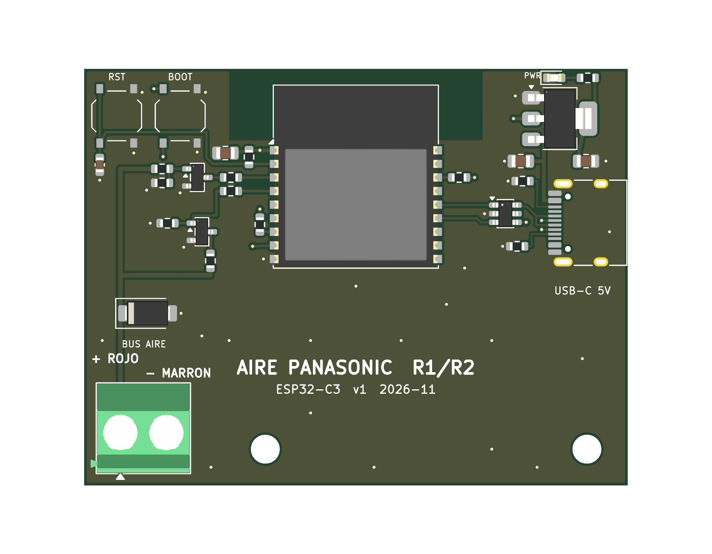

# AC board v1 (ESP32-C3)

A 60 × 46 mm two-layer board that replaces the breadboard/perfboard: an
ESP32-C3-WROOM-02 module, USB-C (power + flashing), and the receive/transmit
circuit proven on the W18BD3P bus. JLCPCB solders everything except the screw
terminal, which they hand-solder too if you leave it in the BOM.

## Files to upload (`fab/`)

| JLCPCB step | File |
| --- | --- |
| Add gerber file | `panasonic_rd_gerbers.zip` |
| Assembly → BOM | `panasonic_rd_bom.csv` |
| Assembly → CPL | `panasonic_rd_cpl.csv` |

## Ordering on jlcpcb.com

1. **Order now → Add gerber file** → `panasonic_rd_gerbers.zip`. The size should
   read 60 × 46 mm, 2 layers. Keep the defaults (1.6 mm, FR-4, HASL lead-free,
   green). Quantity 5.
2. Turn on **PCB Assembly**: Economic, **Top side**, quantity 5 (or 2 to save),
   tick **Confirm Parts Placement** (JLCPCB engineers check every part's
   rotation before soldering; about $0.45).
3. Upload the **BOM** and **CPL**. Every line should match an in-stock part.
   J2 (screw terminal) is through-hole: keep it if you want them to solder it.
4. **Check the placement preview.** Pins 1 of U1 (module), U2, U3, Q1/Q2, D1
   (stripe toward the `+` side) and D2 must sit on the marked pads. Rotate any
   part that looks turned in the viewer, or leave it to *Confirm Parts Placement*.
5. Shipping: **Global Standard Direct Line** (VAT and customs handled at
   checkout) or a **DDP** courier. Pay.

Estimated cost (2026-11-21, before VAT/shipping): about **$55–65 for 5 boards**,
most of it the ESP32 module and the extended-part fees.

## Bringing a board up

1. Plug USB-C into a computer. The red PWR LED lights.
2. Flash `esphome/panasonic-ac-c3.yaml` over USB (`esphome run panasonic-ac-c3.yaml`).
   If it doesn't appear, hold **BOOT**, tap **RST**, release BOOT.
3. AC off at its button. Screw the bus wires in: **red → `+ ROJO`**, **brown →
   `- MARRON`**. Power the board from a phone charger. AC on.

## Design notes

- Receive: BUS+ → 10k/680 divider → Q1 → 1k → GPIO4. Transmit: GPIO5 → 1k → Q2
  (10k to GND) → 220 Ω → BUS+. SMAJ24A across the bus. Bus ground = board ground
  (not isolated), as on the breadboard.
- The 15 V bus traces stay on the left edge, ≥ 6 mm from the module.
- USB-C: CC1/CC2 5.1k pull-downs, USBLC6 ESD on D+/D-; one VBUS pad pair is
  enough (the plug ties its VBUS pins). USBLC6's VBUS pin is left open.
- The module's 0.2 mm thermal vias were removed (JLCPCB 2-layer minimum is
  0.3 mm); its ground pad connects through the ground plane and pin 9.
- No schematic: the board is generated by `build_pcb.py` (pcbnew API), checked
  with KiCad's DRC (0 errors, 0 unconnected) and `make_fab.sh` rebuilds all of
  `fab/`.
