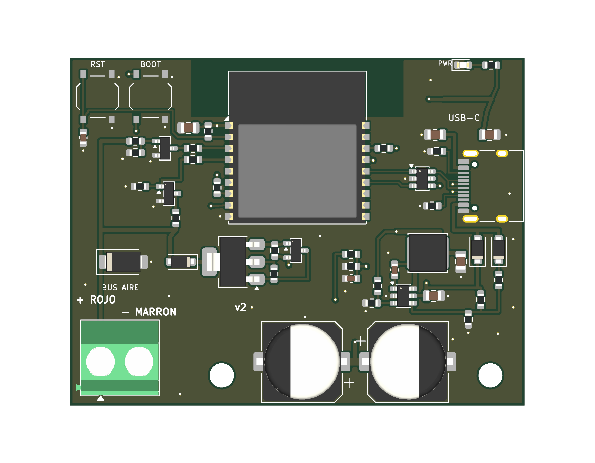

# AC board v2: powered from the AC bus (draft, not ordered)

> ⚠️ **Untested design.** It passes KiCad's design checks, but no v2 board has been built or
> connected to an AC yet. The bus's ability to power it is still unmeasured. Use it at your
> own risk, or wait for test results.

Same 60 × 46 mm board as [v1](../pcb/README.md), but no USB charger needed: it takes its
power from the two bus wires it already listens on. USB-C stays for flashing and as a
backup supply.



**Status (2026-11-22):** designed, KiCad DRC 0 errors / 0 unconnected, firmware
`esphome/panasonic-ac-v2.yaml` compiles. Not built yet. Order it only after v1 works
and the bus current is measured (below).

## How the power works

```
BUS+ ─ D3 SS14 ─ Q3 PZT2222A ─ R21 33 Ω ─┬─ VSTORE: C10 + C11, 2 × 1000 µF ─ U4 TPS560430X ─ L1 10 µH ─ 3.3 V
                   R20 4.7k │  Q4 MMBT2222A┘   (≤ 13.7 V)                     EN: R24 56k / R25 10k
USB VBUS2 ─ D4 SS14 ───────────────────────────┘                             USB: D5 SS14 + R26 10k → EN
```

- **Current limiter.** Q4 turns Q3 down when 33 Ω carries 0.65 V, so the board never
  draws more than **~19 mA** from the bus, whatever the ESP32 does. A steady draw is
  invisible to the 19 kHz signal; the Wi-Fi bursts (~300 mA) come out of VSTORE.
  To change the budget, change R21: 47 Ω ≈ 14 mA, 33 Ω ≈ 19 mA, 27 Ω ≈ 24 mA.
- **D3** stops VSTORE feeding back into the bus when the line is pulled low.
- **Start-up.** U4 only switches on when VSTORE reaches ~8.1 V (EN divider, TPS560430
  threshold 1.23 V) and stops at ~7.3 V, so the ESP32 never boots on a half-charged
  supply. Charging 2 mF to 8 V at 19 mA takes under a second.
- **Wi-Fi gate.** VSTORE / 6.56 goes to IO3. The firmware turns Wi-Fi on only above
  11.5 V (or below 6.5 V, which only happens on USB), turns it off again if VSTORE
  sags to 8 V, and uses Wi-Fi power-save. "Bus supply voltage" shows up in Home
  Assistant as a diagnostic sensor.
- **USB only.** VBUS2 (the connector's A4/B9 pins) feeds VSTORE through D4 (~4.6 V)
  and forces EN on through D5 + R26. The TPS560430 runs from 4 V.
- Gone from v1: the AMS1117 regulator (U3).

## Before ordering: measure the bus budget

1. AC breaker off. Put the multimeter (mA range) in series with one wall-controller wire.
   Breaker on, read the current. That is what the bus already gives one controller.
2. With v1 running, confirm VSTORE math against reality: bus voltage at the terminal
   with the AC idle and while the board transmits.
3. If the controller draws well under 19 mA, raise R21 to 47 Ω (≈14 mA) before ordering.

## Ordering

Same steps as v1 (`fab/panasonic_rd_v2_gerbers.zip`, `_bom.csv`, `_cpl.csv`; Economic,
top side, Confirm Parts Placement). In the placement viewer check the new parts first,
because the rotation fixes in `bom_cpl.py` were confirmed only for v1's parts:
**U4** (TPS560430, SOT-23-6: pin 1 at the ▼ mark), **Q3** (PZT2222A: tab on the left,
on the big pad), **D3–D5** (stripe = cathode, toward Q3 / down), **C10/C11** (+ sides
facing each other in the middle), **L1**.

New parts (all in stock 2026-11-22): TPS560430XDBVR C524782, PZT2222A C189428,
SS14 C2909920, CKCS5040 10 µH C354610, 1000 µF 25 V 10×10.5 C51018391; the rest are
JLCPCB basic resistors/capacitors. Expect about the same price as v1, plus ~$15 of
extended-part fees.

## Risks

- The bus supply's real capacity is unknown. If ~19 mA upsets the indoor unit (error
  code or garbled frames), lower the current (R21) or power from USB: the board works
  the same with a charger.
- First connection to Wi-Fi is the costliest moment. If it keeps cycling on/off, see the
  "VSTORE … Wi-Fi off" log lines and lower `output_power` or raise R21's budget.
- Rebuild: `./make_fab.sh` (same KiCad 10 setup as v1).
