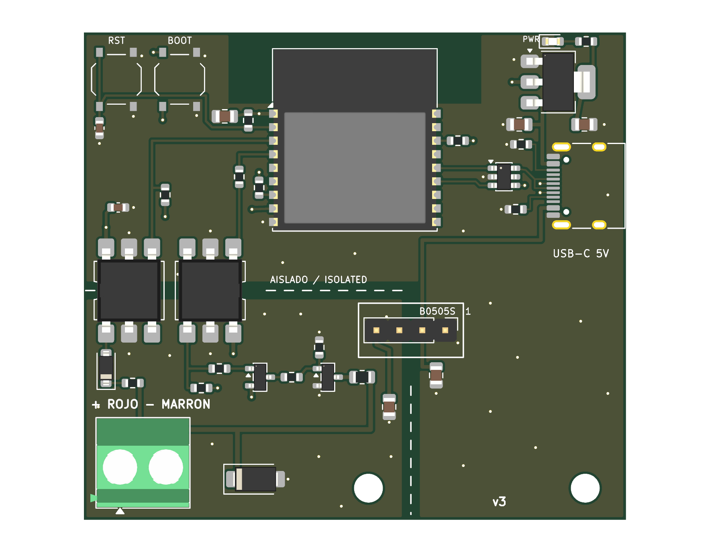

# AC board v3: isolated from the AC bus (draft, not ordered)

Same ESP32-C3 board as [v1](../pcb/README.md), but the ESP32 never shares a wire with the AC
bus. Signals cross a 2 mm gap in the copper through two optocouplers, and the bus-side
transmit stage gets its power from a small isolated DC-DC. Wiring it wrong, a laptop on USB,
or a fault on the AC side can't reach the ESP32. 60 × 54 mm (8 mm taller than v1).



**Status (2026-11-22):** designed. KiCad DRC 0 errors / 0 unconnected, and
`check_isolation.py` reports no bus/ESP32 copper closer than 2 mm except the DC-DC's own pins.
Not built or tested. The firmware is unchanged: `esphome/panasonic-ac-c3.yaml` (RX GPIO4,
TX GPIO5, same polarity as v1).

## Circuit

```
            ESP32 side (GND)                 ║          bus side (BGND = BUS-, floating)
                                             ║
 RX (GPIO4) ── U5 H11L1 out ── 4.7k ── 3V3   ║  U5 LED ── 7.5 V zener ── 2k ── BUS+ (+ ROJO)
                                             ║     └── BUS- (- MARRON)
 TX (GPIO5) ── 680 ── U6 H11L1 LED ── GND    ║  U6 out ──┬── 10k ── V5I
                                             ║           └── 4.7k ── MMBT3906 ── 1k ── MMBT2222A ── 220 ── BUS+
 USB 5V ── B0505S-1WR3 (pins 1-2) ═══════════╬══ (pins 3-4) ── V5I (isolated 5 V) / BGND
```

- **Receive.** The U5 LED conducts only while BUS+ is above ~11 V (7.5 V zener + LED + 2k).
  Idle (15.2 V) = LED on = RX low; carrier dips (7.6 V) = RX high. That is the same polarity
  as v1's transistor, so the decoder needs no change. Bus load: ~3 mA at idle.
- **Transmit.** TX high lights U6. Its output goes low, which turns on the PNP (Q5), the NPN
  (Q6) and pulls BUS+ down through 220 Ω, like v1 and the breadboard. ESP32 off or idle:
  U6 dark, output pulled high, Q5/Q6 off, the bus is left alone.
- **Isolated supply.** The B0505S takes 5 V from USB and makes a floating 5 V (V5I) for U6
  and Q5 on the bus side, so the transmit stage draws nothing from the AC bus.
- **Not polarity-proof.** Red to `+ ROJO`, brown to `- MARRON`, as on v1. Reversed, nothing
  works, but the ESP32 side is still protected.

The isolation is functional (low voltages, keeps the two grounds apart), not a mains safety
barrier: the DC-DC's input and output pins are 2.54 mm apart, which is the module's own
pitch. The B0505S itself is rated 1.5 kV.

## Parts new in v3 (in stock 2026-11-22)

| Part | LCSC | Notes |
| --- | --- | --- |
| H11L1S(TA) ×2 | C78589 | Schmitt-trigger optocoupler, 1.6 mA LED, fast enough for 19 kHz (a PC817 isn't) |
| B0505S-1WR3 | C7465178 | 1 W isolated DC-DC, SIP-4 through-hole: JLCPCB hand-solders it |
| BZT52C7V5 | C707137 | 7.5 V zener |
| MMBT3906 | C7420354 | PNP |
| 220 Ω 0805 | C17557 | bigger than v1's 0603: it carries ~60 mA in bursts |

Removed from v1: Q1/Q2 and their resistors.

## Before ordering

- Order only after v1 works, and test v3 on the real bus first: the optocouplers' switching
  time and the ~3 mA receive load are calculated, not measured.
- In JLCPCB's placement viewer, check the new parts: **U5/U6** (pin 1 = LED anode; U5's LED
  row faces the screw terminal, U6's faces the module), **Q5/Q6**, **DZ1** (stripe/cathode
  toward the 2k resistor). The B0505S uses a generic 4-pin 2.54 mm footprint. The silkscreen
  box shows its body and pin 1 (the pin nearest the right-hand edge).
- Rebuild with `./make_fab.sh`; re-check isolation with KiCad's Python: `python3 check_isolation.py 2.0`.
